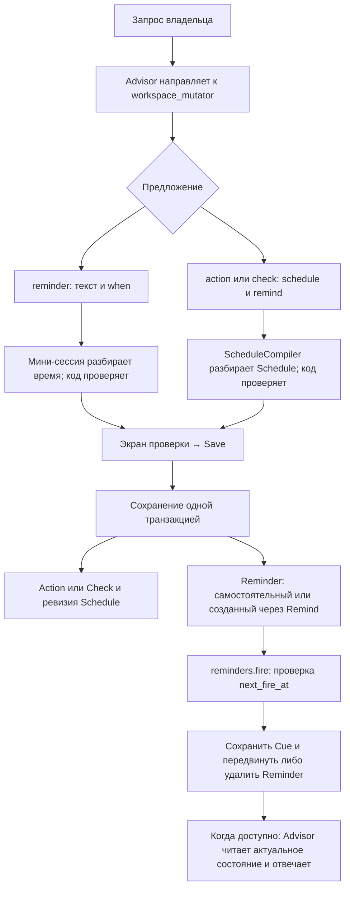
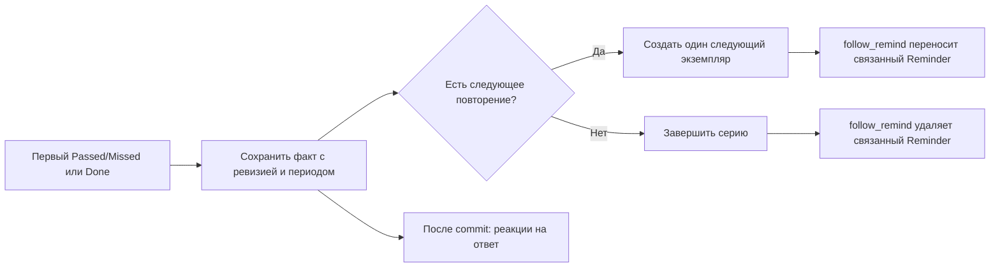

# Напоминания и трекинг в Safwa

Обзор на 22.10.2026. Текущее поведение сверено со сценариями и кодом. Предложения ниже —
для обсуждения, не новый утверждённый контракт.

**Решение по UX: общий метод, инструкции агентов и кнопка трекинга входят в первый этап.**
Пользователю достаточно выбирать «напомнить» или «напомнить и отмечать результат».
«Трекер привычки» — пользовательское название повторяемого Check о привычке, без новой сущности.
Напоминание, Value и условие окончания необязательны. Кнопка выбора трекинга появляется
у каждого нового самостоятельного повторяемого Reminder по времени; модель не решает,
нужна ли она владельцу. Чёткие критерии и изменения review — в разделе 7.

## 1. Что существует сейчас

| Механизм | За что отвечает | Что не делает |
|---|---|---|
| Reminder | Передаёт Advisor инструкцию по времени либо по числу ответов/завершений. | Сам не хранит выполнение привычки и не имеет Passed/Missed. |
| Schedule | Задаёт повторение Action или Check; на Goal задаёт Deadline. Хранит текст и скомпилированную ревизию правила. | Сам не отправляет сообщение. |
| Remind | Включает уведомление в момент Schedule или за несколько минут до него. Создаёт связанный Reminder. | Не требует от модели создавать второй объект вручную. |
| Check | Хранит наблюдение Passed/Missed; без ответа — Pending. Может иметь Values и собственную серию. | Не имеет этапа, трудозатрат и вклада в нагрузку Sprint. |
| Card | Action — планируемая работа и Done; Goal — результат с Deadline и дочерними Cards. | Done действия не означает серию ежедневных успехов без пропусков. |

Schedule поддерживает квоты за день/неделю/месяц, конкретные даты и часы, дни недели/месяца,
интервалы и повторение после завершения. Возможны общее число повторений и последняя дата.
«Каждое утро» допускается как ежедневный Schedule без точного часа, но для Remind нужен час.
Один раз разобранное правило исполняется кодом; модель не пересчитывает календарь при каждом ответе.

У серии один открытый экземпляр. Новый появляется после Done либо первого Passed/Missed,
а не автоматически каждое утро. Исправление старого ответа не создаёт новый экземпляр.
Обычный Check на Action следует циклу Action. Check со своим Schedule может находиться на Goal
или отдельно, но не на Action. Закрытие Goal завершает его серии Checks после последних ответов.
Ответ на Check сам по себе Goal не закрывает. Связи Check с Values переходят к следующему экземпляру.

Источники: [Schedule](SCHEDULES.md), [Checks](DOMAIN.md#checks), сценарии
[SCH](../tests/brd/schedules.feature), [CH](../tests/brd/checks.feature),
[RM](../tests/brd/reminders.feature), [CD](../tests/brd/cards.feature).

## 2. Потоки и задействованные механизмы

### Создание и исполнение по времени

Две ветки сохранения на схеме — альтернативы: самостоятельному Reminder не нужен Check.
При Remind обе записи сохраняются вместе. Ошибка разбора возвращается до сохранения.
Предложение Reminder или включения Remind требует экрана проверки владельцем.

Фоновый цикл проверяет время каждые 30 секунд; время сообщения зависит также от занятости чата
и ответа модели. За раз берётся до трёх напоминаний. Cue — сохранённая просьба для будущего хода:
она записывается в той же транзакции, которая передвигает Reminder. Повтор с опозданием более
120 минут переносится без сообщения; одноразовый Reminder приходит даже с большим опозданием.
При старте процесса расписания сверяются после простоя. Доставка не отмечает Check выполненным.

### Ответ и продолжение серии

Remind следует также за переименованием, изменением Schedule и удалением объекта. Если ответа нет,
повторяемый Reminder продолжает приходить, а Check остаётся тем же Pending. Пропущенные даты
не превращаются в отдельные Missed. Лимит Schedule считает Done у Action и **оба** ответа у Check;
новая ревизия начинает свой лимит с нуля. Последняя дата запрещает последующие экземпляры,
но уже открытый остаётся до ответа.

### Реакции после сохранения

| Механизм | Когда и что делает |
|---|---|
| `checks.check_review` | На создание Check запускает мини-сессию проверки смысла. При проблеме предлагает обсудить исправление; автоматически не заменяет объект. Копии серии не проверяет. |
| `values.link_clarification` | При добавлении связи с Value проверяет её смысл и при неясности предлагает уточнить Note. Это уже существующая дополнительная проверка. |
| `checks.missed_run` | На 3, 6, 9… Missed подряд просит Advisor обсудить препятствия. Pending пропускает. |
| `reminders.condition` | На новый ответ Check или Done Action проверяет условные Reminder. Исправленный ответ Check их не запускает. |
| `schedules.end` | При достижении лимита или невозможности следующего экземпляра до последней даты предлагает обсудить повторный запуск. |
| `cards.schedule_plan` | В полночь и на старте переносит подходящие Actions в Today/Sprint. Checks в нагрузку плана не добавляет. |

Условный Reminder уже понимает «после 30 Passed подряд у этого Check». Подготовка использует
две мини-сессии: разбор условия и SELECT нужных экземпляров. При каждом новом ответе код снова
исполняет SELECT, считает выбранную историю и создаёт Cue на кратных порогу значениях.
Сам Reminder сохраняется; достижение порога не завершает Check и не фиксирует отдельный статус успеха.
Встроенный Repeated Missed и самостоятельно созданный Reminder на те же Missed могут обеими
реакциями внести одну тему в очередь.

Код потоков: [компилятор](../src/safwa/features/schedules/agent.py),
[привязка Remind](../src/safwa/features/schedules/use_cases.py),
[доставка](../src/safwa/features/reminders/firing.py),
[условия](../src/safwa/features/reminders/conditions.py),
[ответы Checks](../src/safwa/features/checks/use_cases.py), [контракт хуков](HOOK_ARCH.md).

## 3. Где домен мешает вашему сценарию

1. **Граница Check/Action противоречит привычному пониманию трекера.**
   Правило Check: наблюдение состояния, а «я сделал» — Action. Пример «сделал зарядку?»
   прямо признан неподходящим. «Выпил воду утром?» попадает в ту же смысловую зону.
   Одной инструкции Advisor «привычка — Check» недостаточно: Check review и Onboarding
   будут учить обратному. См. [метод Check](../src/safwa/features/checks/api.py) и CH-REVIEW-019.
2. **Создание Check с Value искусственно разбито.**
   `CheckToolInput` разрешает при создании только название, Note, Schedule и Remind.
   Values добавляются отдельным вызовом link с уже существующим ID. Это дополнительный шаг
   после создания именно для запроса «трекер воды, связанный со Здоровьем».
   [Инструмент](../src/safwa/features/checks/agent.py), [сохранение](../src/safwa/features/checks/proposal.py).
3. **Три разных счётчика легко перепутать.**
   30 срабатываний Reminder; 30 ответов по Schedule; 30 Passed подряд — разные условия.
   Ни одно автоматически не означает «30 утр подряд». Отсутствие ответа не рвёт текущую
   последовательность ответов; календарные пропуски не материализуются. Поэтому Schedule
   с лимитом 30 не подходит для обещания «привычка успешна после 30 выполнений подряд».
4. **Время побуждения и время оценки могут различаться.**
   В 07:00 полезно сказать «Пора выпить воду», но ещё рано записывать Missed.
   У Schedule с часом сейчас одна временная опора; Remind умеет быть в этот момент или раньше.
   «Напомнить в 07:00, оценить утром до 10:00» — отдельная будущая семантика, не простое
   переименование поля.
5. **Модели приходится разбираться в устройстве серии.**
   Значение Value хранится на текущем Check, а ответы — на предыдущих. SELECT только по
   `direct_values` не даёт всей истории привычки: сначала нужно выбрать серии, затем их ответы.
   Для одного известного трекера ссылка на серию надёжнее генерируемого SELECT.
   [Перенос связей](../src/safwa/features/checks/use_cases.py), [представление](../src/safwa/features/checks/views.py).

## 4. Сравнение вариантов

| Вариант | Польза | Цена и вывод |
|---|---|---|
| Review-хук после создания повторного Reminder | Может предложить связь с Value в контексте владельца. | Дополнительная модель, очередь вопроса, согласие, замена уже сохранённого объекта. Повторяемость сама по себе не означает желание трекать. Для основного пути слишком много шагов. |
| Каждый Reminder становится Check | Один вид объекта на поверхности. | Произвольные просьбы Advisor и уведомления получают ненужные ответы, историю и реакции. Потребуется режим «не учитывать», то есть скрытое возвращение различия. Не рекомендую. |
| Разговорное предложение до создания | Advisor объясняет трекер на примере запроса; Mutator создаёт сразу нужный объект. | Дополняет кнопку, но её доступность не зависит от решения модели. |
| Кнопка выбора трекинга до Save | Возможность видна независимо от того, догадалась ли модель её предложить. | Входит в первый этап. Владелец сам решает, что отслеживать, включая получение или просмотр сводки. |

## 5. Предлагаемый UX и упрощение для SLM

### Сначала — единый язык агентов

**Трекер привычки = повторяемый Check, который отмечает соблюдение привычки.**
Remind включает уведомление. Value объясняет, чему привычка служит. Окончание ограничивает
срок наблюдения. Критерий успеха определяет желаемый результат. Эти связи и настройки
не обязательны для самого трекера.

Не каждый повторяемый Check нужно называть привычкой: «Осанка прямая?» может быть трекером
наблюдений. Механизм один; пользовательское название следует смыслу запроса. Бессрочный
«Отмечай, выпил ли я воду утром» остаётся полноценным трекером. «До конца месяца» делает
его ограниченным по времени, но не задаёт успех. «30 Passed подряд» задаёт цель, однако
сейчас не поддерживается как автоматическое условие остановки Schedule.

Предлагаемое содержание инструкций, пока не внесённое в рабочие промпты:

| Получатель | Что ему нужно знать и делать |
|---|---|
| Общий метод для Advisor и Mutator | Check отмечает факт да/нет, включая выполнение привычки. Повторяемый Check о привычке — её трекер. Action планирует работу. Напоминание и окончание трекера необязательны. |
| Advisor | Прямой запрос трекера направлять в Mutator. При запросе только напоминания о повторяемом личном действии можно один раз предложить учёт результата, до создания; не включать его без согласия. При «просто напоминай» сразу сохранять выбранный смысл. |
| Mutator | Для согласованного трекинга использовать `check` с Schedule; `remind` — только если просили уведомлять. Value — названная или подтверждённая владельцем. Не создавать отдельный Reminder на то же время и не придумывать срок окончания. |
| Onboarding | Объяснять на одном примере: «Отмечай, пью ли я воду утром; напоминай в 07:00; свяжи со Здоровьем». Объяснять, что можно без напоминания и без конца; не требовать знать слово Check. |

В примере с водой Advisor может предложить: «Могу также отмечать, получилось ли, и показывать
историю привычки. Связать со Здоровьем?» До ответа это предложение, а не выбранное намерение.
После отказа обычное напоминание не становится поводом снова предлагать трекинг при каждом
срабатывании. Для просьбы «каждый понедельник присылай сводку» модель не включает трекинг сама,
но кнопка доступна: владелец может захотеть отмечать, например, просмотр сводки.

Новая формулировка заменяет прежний запрет «выполненная работа не бывает Check». Это стоит
токенов, потому что устраняет конфликт между созданием и review; повторять её развёрнуто
в трёх промптах не нужно. Подробности подсчёта и ограничения серии должны оставаться в коде
и результатах инструментов, чтобы не вытеснять правила чтения данных и работы с предложениями.

### Кнопка входит в первый этап; её включение — выбор владельца

На запрос «Напоминай каждое утро в 07:00 пить воду» показать обычное предложение напоминания
и необязательный выбор **«Также отмечать выполнение»**, изначально выключенный.
В этом варианте она **всегда** видна на экране создания нового самостоятельного повторяемого
Reminder по времени, включая интервалы и ограниченные повторы. Это проверка структуры
расписания кодом, без классификатора привычек. При редактировании, у одноразового или условного
Reminder и у Remind существующей Card/Check её нет. У повторяемых сводок она также видна:
содержание напоминания не позволяет заранее решить, нужен ли владельцу учёт.
Не заставлять отвечать на дополнительный вопрос, если нужно просто напоминание.

При включении открыть подготовку трекера: подтвердить наблюдаемый факт («Выпил воду утром?»)
и при желании выбрать Value. Произвольную инструкцию вроде «Обсуди со мной планы» нельзя
механически превратить в вопрос да/нет. До Save показать окончательные поля и объект.

Для примера результат выглядит так:

> Отмечаем: выпил воду утром. Повторяем каждый день. Напоминаем в 07:00.
> Ценность: Здоровье — если владелец выбрал или подтвердил её. Ответы: Да / Нет.

Save создаёт Check, Schedule, связь с Value и связанный Reminder в одной транзакции.
Самостоятельный Reminder сначала не создаётся. При переключении режима уже разобранное время
можно использовать повторно, проверив совместимость; повторный разбор тех же слов не нужен.
Лимит отправок Reminder нельзя автоматически переносить в лимит ответов Check.
Это предложение потребует доработки подготовки, экрана и сохранения, а не только текста кнопки.

При прямом «создай трекер» выбор режима уже сделан владельцем. Для существующего Action или Check
«напомни о нём» по-прежнему включает его Remind и не создаёт дубль трекера.

**Предлагаемая граница сущностей:** Action — когда нужно планировать работу и её нагрузку;
Check — когда нужно отмечать наблюдаемый факт да/нет, включая факт выполнения привычки.
Одна и та же деятельность может использоваться по-разному в зависимости от намерения владельца.
Это изменение метода, особенно CH-REVIEW-019, а не уже существующее разрешение.

Для SLM наиболее полезны четыре небольших изменения:

- Разрешить Values при создании через существующий `check`, с одним экраном и Save.
- Согласовать единое определение Check и примеры в методе, Check review и Onboarding;
  коротко объяснить Advisor выбор по намерению. Не добавлять отдельного агента привычек.
- Оставить календарную арифметику, перенос Reminder и подсчёты в коде. Не отдавать модели
  сборку связки из трёх объектов и получение промежуточных ID.
- Если добавлять цель по серии, передавать известную серию и тип счётчика структурированно;
  не просить SLM писать SQL для одного трекера. Произвольные условия по группам оставить
  возможностью существующих Reminder, а не обязательным путём каждой привычки.

Все Values уже доступны в контексте mutator. Отдельный хук с ещё одним списком Values
не устраняет главный пробел: пользователь не знает, что можно включить трекинг.
Эффект на точность SLM здесь — гипотеза по устройству потока, не результат нового замера.

## 6. «30 подряд» и порядок работ

Для первого шага достаточно повторяемого Check, уведомления и истории Да/Нет.
Полноценный критерий успеха лучше сделать следующим отдельным изменением:

- Различать «30 успешных ответов подряд» и «успех в 30 последовательных запланированных днях».
- Для второго варианта считать по слотам Schedule. Неотвеченный завершившийся слот не должен
  подтверждать непрерывность, но превращать неизвестное в Missed без решения владельца не нужно.
- Отделить цель от лимита повторений: изменение часа не должно случайно обнулять прогресс цели.
- Определить эффект достижения: сообщение один раз, продолжение наблюдений или завершение серии.
  Нынешний условный Reminder сообщает на 30, 60… и не является таким состоянием цели.

Порядок: **общий метод и review → инструкции агентов, создание с Value и кнопка → цель серии**.
Кнопка входит в первый этап работы с трекером независимо от качества разговорного предложения.
Будущие изменения промптов обсуждаются отдельно: они добавят понятный выбор по намерению и
один пример трекера, но займут внимание, сейчас отданное различию работы и наблюдения.
Следует заменить конфликтующие правила, а не наращивать исключения поверх них.

Проверка будущего решения: вода с трекингом создаёт одну серию и один связанный Reminder;
«просто напоминай» не создаёт Check; отказ не оставляет записей; существующий объект не
дублируется; смена расписания переносит уведомление; Missed не считается успехом;
календарный пропуск не выдаётся за непрерывный успех. На SLM проверить перефразировки этих
запросов и сравнить правильность выбора, число вызовов, исправлений и экранов сохранения.

Направление изменения Check согласовано в обсуждении; конкретные критерии ниже пока являются
проектом. Открыты точный смысл «30 подряд» и действие при достижении цели. Ни удаление Reminder,
ни новый review-хук для этого не обязательны.

## 7. Чёткие критерии сущностей и изменения review-хуков

### 7.1. Основное правило выбора

**Тип определяется тем, что владелец хочет учитывать. Review проверяет допустимость выбранного
типа, а не ищет единственный «правильный» тип по названию деятельности.**

| Намерение владельца | Тип | Пример |
|---|---|---|
| Сохранить направление, которому хочется следовать | Value | «Здоровье», с объяснением смысла и повседневных проявлений. |
| Достичь конкретного конечного результата | Goal | «Пробежать полумарафон»; «30 запланированных утр подряд с выполненной привычкой». |
| Запланировать конкретную работу и учитывать её выполнение/нагрузку | Action | «Поставь пробежку на завтра в Today». |
| Записывать, состоялся ли определённый факт | Check | «Каждый вечер отмечай, бегал ли я сегодня». |
| Получать сообщение без учёта результата | Reminder | «Просто напоминай мне утром о пробежке». |

При явно выбранном допустимом типе не предлагать другой только потому, что он тоже подходит.
«Трекер», «отмечать», «вести историю да/нет» означают Check; «в план», «в Today/Sprint»,
«учитывать нагрузку» означают Action. Просьба только напоминать не означает согласия на Check.
Если цель запроса неясна и меняет учёт, спросить о желаемом результате: «Планировать это как
работу или только отмечать, получилось ли?» Не просить выбирать термин Safwa.

Длительность деятельности, её повторяемость и наличие конца **не являются сами по себе
разделителями Action/Check**. «Читал 20 минут?» допустим как Check; «Читать 20 минут в Today» —
как Action. Не создавать оба автоматически для одного факта. Если владелец хочет план и
отдельный контроль качества, Action и его Check могут иметь разные критерии.

### 7.2. Value: зачем это важно

Допустимая Value соответствует всем условиям:

1. Называет устойчивое направление, которое нельзя окончательно выполнить и закрыть как Done.
2. Не сводится к одной практике, конечному результату или правилу «всегда/никогда».
3. Описывает движение к желаемому; не только избегание, желаемое чувство или средство
   получить что-то другое. Если это средство, описание объясняет его самостоятельный смысл.
4. Описание основано на словах владельца: почему важно и что он делает для этого в обычной жизни.
   Если название касается других людей, в описании есть действия самого владельца.

**Изменить Value review:** убрать категорическое «практика — это повторяемый Action».
«Бег» как единственная практика по-прежнему не проходит как Value, но совет должен спросить,
чему он служит; затем допускаются Action для планирования или Check для трекинга.
Не превращать названия «Здоровье» и «Семья» в проблему из-за их общности, если описание ясно.
Наличие привычек в описании Value нормально и не превращает саму Value в Check.
Не оценивать за владельца важность Value и не требовать Goal или трекер под каждой Value.

Где: метод VALUE в [values/api.py](../src/safwa/features/values/api.py), пример про Running
и направление совета в [value_review.py](../src/safwa/features/values/value_review.py).
Смысл самой Value сохраняется; меняется навязанная альтернатива. Сценарий: VL-CLARIFY-022.

### 7.3. Goal: какой конечный результат должен наступить

Допустимая Goal соответствует всем условиям:

1. Называет один конкретный конечный результат, не бессрочную деятельность.
2. В названии или Note есть проверяемый факт для Done. «Регулярно» без критерия недостаточно.
3. Достижение занимает больше одного дня; один рабочий шаг остаётся Action.
4. Если есть родительские Goals, результат продвигает результат каждой из них.

Deadline необязателен. Достижимость и ценность результата не определяются review за владельца.
Число, длительность и порог успеха берутся из его слов, а не добавляются ради «хорошей цели».

**Изменить Goal review:** бессрочное «Медитировать ежедневно» всё ещё не Goal, но совет
больше не обязан вести к Action. Предложить трекер, если нужен учёт, либо Action, если нужна
работа в плане. «Отметить медитацию в 30 последовательных запланированных днях» — допустимый
конечный результат, когда именно это выбрал владелец. Не требовать отдельного Goal только
потому, что Check повторяется до даты или ограничен числом наблюдений.

При отдельной Goal её Check хранит наблюдения; Goal хранит смысл конечного результата.
Связь не даёт автоматического Done по числу ответов. Это остаётся явным завершением владельцем,
пока отдельно не согласована и не реализована автоматизация критерия.

Где: метод GOAL, его правило об ongoing practice и пример Meditate daily в
[cards/api.py](../src/safwa/features/cards/api.py); [goal_review.py](../src/safwa/features/cards/goal_review.py)
получит критерии из метода. Сценарий: CD-GOAL-051.

### 7.4. Action: какую работу запланировали

Допустимая Action соответствует всем условиям:

1. Называет один конкретный исполнимый шаг, который можно начать и закончить.
2. Один экземпляр укладывается в один день. У повторяемой Action это относится к каждому
   выполнению, а не ко всей серии.
3. Представляет работу; голое состояние «Осанка прямая» без действия — Check.
4. Продвигает свои Goals, если они есть. Отсутствие родителя само по себе не ошибка.

Проверки Categories, Energy и включённых Effort Points сохраняются: совет только при явном
несоответствии, с учётом контекста и собственных указаний владельца. Повторяемая работа
не становится ошибочной Action из-за того, что её также можно отслеживать привычкой.

**Изменить Action review:** добавить защиту от такого переубеждения и парный пример
«Запланированная пробежка» / «Бегал сегодня?». Если владелец явно просил лишь историю да/нет,
а был создан Action, предложить Check как исправление намерения; по одному короткому названию
такое намерение не угадывать. Существующих последних пяти обменов для этого достаточно;
новую модель классификации и дополнительные списки не добавлять.

Где: метод ACTION в [cards/api.py](../src/safwa/features/cards/api.py), примеры и ограничения
совета в [action_review.py](../src/safwa/features/cards/action_review.py). Сценарий: CD-ACTION-052.

### 7.5. Check: какой факт отмечаем

Допустимый Check соответствует всем условиям:

1. Один ответ да/нет имеет однозначный смысл: соблюдён заданный критерий или нет.
2. Есть наблюдаемый факт. Допустимы состояние, результат, выполненное действие и воздержание.
3. Критерий понятен из названия и Note; период наблюдения — из них и Schedule, если он нужен.
4. На Card он проверяет факт, относящийся к её результату. Собственный Schedule допустим
   отдельно или на Goal, но не на Action — это существующая структурная проверка кода.

**Изменить Check review:** удалить запреты «выполненная работа — не Check» и «всё, что занимает
время, — Action». Длительность может быть условием факта: «Читал не менее 20 минут?».
У Check по-прежнему нет собственных трудозатрат и этапа плана. Пример «Сделал утреннюю зарядку?»
становится clear; «Был хорошим отцом?» остаётся unclear без наблюдаемого критерия.
«Сколько минут читал?» требует числового ответа и не подходит: спросить, какой бинарный
критерий нужен, не придумывая порог. При неясном критерии сначала уточнять сам Check,
а не предлагать Action как универсальное исправление.

Не требовать Remind, Value, дату окончания, число повторов или Goal. Не считать отсутствие
ответа Missed и не оценивать полезность привычки. Для review остаются нынешние title, Note,
Schedule и Card; длительную историю и все Values загружать не требуется.

Где: определение, критерии и примеры CHECK в [checks/api.py](../src/safwa/features/checks/api.py),
описание и направление совета в [check_review.py](../src/safwa/features/checks/check_review.py),
описание инструмента в [checks/agent.py](../src/safwa/features/checks/agent.py).
Сценарий CH-REVIEW-019 требует явной смены исхода примера про зарядку.

### 7.6. Связь с Value и общие ограничения review

Проверка связи нужна отдельно от проверки сущности: факт Passed показывает, как владелец
реализовал Value согласно её описанию. Само нажатие «Да» не служит Value. «Выпил воду утром?»
может поддерживать «Здоровье»; «Мне нужно здоровье, чтобы заработать» — обратная зависимость,
которая не доказывает связь заработка со Здоровьем.

В метод LINK добавить пример привычки и уточнить, что оценивается отмечаемый факт, включая
выполнение действия. Сохранить правила: очевидная связь не требует объяснений; при неоднозначной
связи спросить владельца; его понятное объяснение учитывается. Не назначать Value автоматически.
Достаточно существующего `values.link_clarification`; хук со списком всех Values не нужен.
Сценарии: VL-LINK-018 и VL-LINK-019.

Общий результат review: clear, когда критерии выбранного типа соблюдены; иначе — конкретное
нарушение и один следующий шаг. Допустимая альтернатива не является нарушением. Исправления
предлагаются владельцу, но не применяются автоматически. Оставить текущие триггеры создания,
защиту от устаревшего объекта и отсутствие повторного review на каждой копии серии.
Числовые ограничения и допустимость связей проверяет код, а не ещё одна модель.

### 7.7. Что согласовать вместе, чтобы хуки не спорили

Определения, критерии и примеры редактировать в существующих Method, откуда собираются
review-промпты и общий блок Advisor/Mutator. Onboarding и Compass должны объяснять тот же метод.
Не копировать эту подробную секцию в каждый системный промпт: короткие определения — всем,
узкие критерии и несколько парных примеров — соответствующему review.

Проверить также два соседних правила, которые иначе сохранят старую классификацию:

- В ACTION и ответе компилятора частота выше пяти в день сейчас ведёт к совету «сделать Check».
  Сам лимит можно сохранить; предлагать Check следует только для учёта факта, не как обход
  ограничений планирования реальной работы. Частота не должна определять тип.
- Если Goal используют для конечного результата трекера и под ней есть только Checks,
  `cards.empty_parents` сейчас каждое утро просит добавить Actions. Перед поддержкой такого
  пути нужно отдельно согласовать его поведение: наличие Check-наблюдения само по себе ещё
  не доказывает, что у Goal есть способ достижения. Не создавать фиктивный Action ради хука.

Минимальные проверочные пары для новой версии метода:

| Случай | Ожидаемый результат review |
|---|---|
| Value «Здоровье» с ясным описанием привычек | clear; не требует переводить описание в Actions. |
| Value «Пить воду по утрам» как одна практика | unclear; спросить о направлении, предложить подходящий способ учёта практики. |
| Goal «Медитировать ежедневно» без конечного результата | unclear; уточнить результат или предложить трекер/Action по намерению. |
| Goal с указанным владельцем критерием 30 последовательных дней | clear, если определён факт успеха и соблюдены остальные критерии Goal. |
| Action «Пробежка» в плане, с подходящими остальными полями | clear; повторяемость не повод переводить её в Check. |
| Check «Бегал сегодня?» или «Читал 20 минут?» | clear; длительность деятельности не повод переводить его в Action. |
| Check «Был хорошим?» без критерия | unclear; спросить, какой факт означает «да». |
| Повторяемый Check без Remind, Value и окончания | clear, если понятен отмечаемый факт. |
| Просьба «30 успешных утр подряд» | Лимит 30 ответов не выдаётся за реализацию критерия; проверяется отдельно от качества текста Check. |

Перед внедрением согласовать новые исходы сценариев, заменить конфликтующие формулировки
во всех перечисленных местах и обновить затронутый prompt snapshot. Затем проверить
классификацию и отсутствие взаимных исправлений на парных запросах к SLM. В этом документе
изменения описаны; рабочие промпты, хуки и утверждённые сценарии пока не изменены.

## 8. Conditions: что сохранить и что упростить

**Основа хорошая: условие — выбор объектов, вид ответа, порог и способ подсчёта.**
Модель нужна при подготовке, а на каждом ответе работают обычный код и сохранённая очередь.
Слабые места — выбор экземпляров через произвольный SQL и определение момента достижения порога.
Для надёжного трекера сначала нужно исправить их, затем добавлять критерии успеха.

### 8.1. Что уже сделано удачно

- Условия реагируют на сохранённые ответы Check и Done Action, без опроса модели по таймеру.
- Подсчёт переиспользует историю ответов; отдельного постоянно синхронизируемого счётчика нет.
- Pending не считается ни успехом, ни неудачей; исправление ответа не выдаётся за новый ответ.
- Запрос проверяется как разрешённое чтение, выполняется до Save, экран показывает найденные
  серии. Синтаксические ошибки могут быть исправлены до сохранения.
- Подходящие объекты выбираются заново: новые Actions с нужным Tag участвуют автоматически.
- Для доставки используется существующая Cue. Второго механизма сообщений не требуется.

Сейчас путь такой: слова владельца → разбор условия моделью → ещё одна мини-сессия пишет SELECT
экземпляров → проверка и Save → новый ответ → SELECT → подсчёт текущей истории → Cue.
Оставить общий путь исполнения; не строить универсальный движок правил с произвольными
операторами, цепочками условий и действиями.

### 8.2. Подтверждённые проблемы

Проверено пятью временными диагностическими случаями на тестовой базе и настоящими доменными
операциями. В первых двух использовался настоящий обработчик событий после commit.
Рабочий код не исправлялся; временный диагностический файл удалён после проверки.

| Случай | Что получилось сейчас | Почему это важно |
|---|---|---|
| Условие «каждые 3 ответа»; Done одной Action одновременно отвечает на 3 Checks | Созданы **3 одинаковые Cue**. | Каждый обработчик видит уже итоговые 3 ответа и считает свой вызов достижением порога. |
| То же, но одновременно отвечают 4 Checks | Создано **0 Cue**. | Итоговое 4 не кратно 3; прохождение порога не учитывается. |
| Условие на Check #N; его серия продолжилась, затем первый экземпляр #N удалён | SELECT перестал находить серию, хотя следующий экземпляр существует. | Пример SQL из промпта сначала ищет series_id через удаляемую строку #N. |
| В серии уже 2 Passed; новая ревизия Schedule разрешает ещё 2 ответа; запрашивается порог 3 Passed всего | Подготовка отклоняет порог как недостижимый, хотя следующий ответ действительно даёт 3 Passed. | Проверка достижимости смотрит лимит последней ревизии, а `count_now` считает историю нескольких ревизий. |
| Check связан со Здоровьем; SELECT фильтрует `direct_values`; сохранён Passed и создан следующий Check | Корректный по валидатору SELECT находит только Pending-преемника, условие не срабатывает. | Value переходит к преемнику; фильтрация экземпляров не равна выбору серий с последующим подсчётом всей истории. |

Последний случай показывает хрупкость допустимого SQL, а не поломку любого запроса по Value:
более сложный SELECT по сериям может работать. Но правильный способ приходится изобретать SLM.
Аналогично валидатор не запрещает фильтр только по Passed: такой запрос выкинет Missed из
истории и исказит «подряд», хотя запрет фильтровать ответы есть в промпте.

Источники: [выбор и подсчёт](../src/safwa/features/reminders/conditions.py),
[цикл срабатывания](../src/safwa/features/reminders/firing.py),
[обработчик ответа](../src/safwa/features/reminders/hooks.py),
[проверка достижимости](../src/safwa/features/reminders/proposal.py),
[построение SELECT](../src/safwa/features/reminders/agent.py).

### 8.3. Семантику нужно показывать явно

| Вопрос | Сейчас | Предложение |
|---|---|---|
| «После 30» или «каждые 30»? | Условие с порогом 30 повторяется на 30, 60, 90…; самостоятельного одноразового достижения нет. | Различать одно достижение и каждое N-е. Для цели привычки обычно нужно одно; прекращение Check — отдельное решение. |
| С какого момента считаем? | Вся найденная история, включая ответы до создания Reminder. Создание само по себе не запускает условие. | Явно показывать это и текущий счётчик до Save. Не добавлять режим «сейчас» без запроса; при уже достигнутой одноразовой цели согласовать, сообщить сейчас или начать новый цикл. |
| Что означает «подряд»? | Последние совпадающие ответы до первого другого ответа; Pending и календарные пробелы пропускаются. | Называть это «подряд среди ответов». Календарную непрерывность реализовывать отдельно по Schedule. |
| Несколько Checks в одном условии? | Их ответы объединяются в одну последовательность по времени ответа и ID. | Для одной привычки выбирать одну серию. У групп явно показывать, что считается общий поток, а не независимая серия успехов каждой привычки. |
| Что меняется при выборе по Value/Tag? | Состав определяется текущим SELECT при каждом ответе. | Явно определить выбор серий по текущим связям; затем считать историю этих серий. Смена состава может изменить итог, это не новый ответ. |

Это границы поведения, а не дополнительные инструкции на каждый ход Advisor.
Экран подготовки может показывать: «Этот трекер; Passed; 30 ответов подряд; вся история;
сейчас 12; уведомить один раз». Само одноразовое уведомление пока является предложением,
а не существующей возможностью.

### 8.4. Минимальное направление изменений

**Первое — правильное достижение порога.** Обрабатывать пакет новых фактов как пакет:
порог 3 при переходе 0 → 3 или 0 → 4 достигается один раз. Повторная проверка того же
достижения не должна создавать ещё одну Cue. Если пакет пересекает несколько порогов,
рекомендую одно сообщение с перечислением достигнутых порогов. Учитывать порядок новых
ответов, особенно когда Passed и Missed в одном пакете: один итоговый остаток от деления
для этого недостаточен. Не устранять проблему только объединением готовых сообщений —
оно не вернёт пропущенный порог. Один сохранённый «последний счётчик» тоже не универсален:
после Missed новая успешная последовательность может снова достичь того же числа.

**Второе — выбирать серии, затем их ответы.** Для конкретного Check/Action код при подготовке
разрешает его ID в устойчивый ID серии. Условие хранит этот выбор без зависимости от сохранности
первого экземпляра. Выбор серии не фильтрует её ответы по исходу; Passed/Missed/Done применяет
общий счётчик. Для групп отдельно определяются серии по текущим связям, затем берётся их история.
Исправить проверку достижимости так, чтобы её область совпадала с областью счётчика; отклонять
только доказанно недостижимое условие, не строить сложный прогноз будущих ревизий.

**Третье — убрать лишнюю генерацию SQL в обычном случае.** Если условие относится к одному
известному трекеру, модель передаёт ссылку на него, ответ, порог и «подряд/всего»; код выбирает
серию. Отдельная мини-сессия для SELECT здесь не нужна. Сложные динамические группы можно
оставить существующему механизму запросов, пропуская их через тот же выбор серий и счётчик.
Не вводить второй счётчик для простых условий и собственный язык фильтров на все будущие случаи.

**Четвёртое — добавить одноразовое достижение, если оно входит в выбранный сценарий.**
Состояние «уже сообщили» нужно сохранять вместе с Cue; иначе повторная обработка снова поздравит.
Оно принадлежит реакции на достижение. Schedule продолжает отвечать за время повторений,
а явное завершение трекера или Goal — за их жизненный цикл. Условие уведомления не должно
незаметно означать удаление Reminder, остановку Check и Done Goal одновременно.

Оптимизацию чтения всей истории на каждый ответ оставить после этих исправлений и замера:
сейчас `count_now` загружает ответы в Python, а обработчик перебирает все условные Reminder.
Для личного бота это ещё не доказанная проблема производительности. Простой SQL-подсчёт общего
количества возможен, но кеши, отдельный журнал исполнения и фоновые пересчёты пока не оправданы.

Критерии проверки будущего изменения: один пакет 3/4 ответов не дублирует и не теряет порог 3;
новая последовательность после Missed снова может достичь своего порога; удаление старого
экземпляра не отвязывает живую серию; история по Value включает ответы предыдущих экземпляров;
смена ревизии не даёт ложного отказа; одноразовое и повторяемое условия различаются на экране.
Новые исходы и смысл групп нужно согласовать со сценариями RM-COND-030–035 перед реализацией.

Мой приоритет: **корректность порогов → устойчивый выбор серии → меньше работы SLM → одноразовая
реакция на цель**. Существующий механизм доставки и разделение подготовки/исполнения сохранить.
