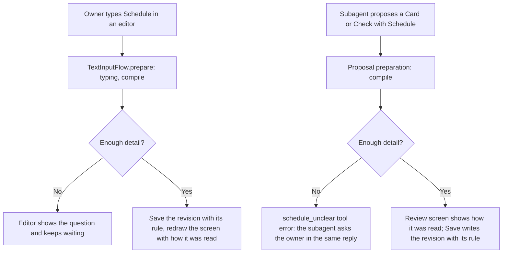
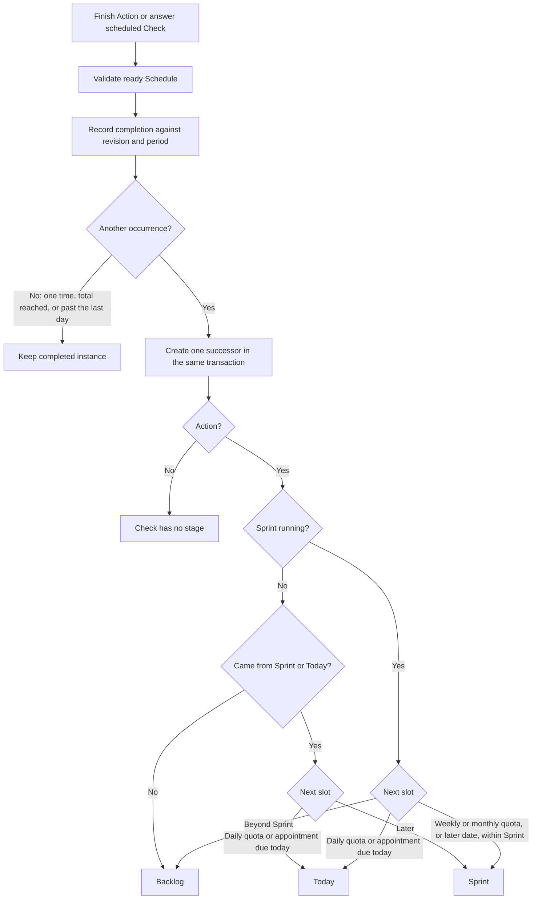
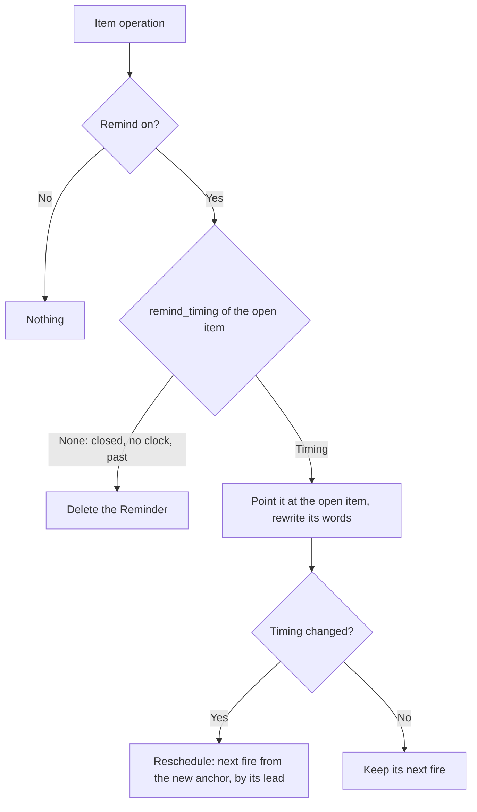

# Schedule

An Action or a Check carries one `schedule` text field: when it repeats or
happens, in the owner's words. On a Goal or a Subgoal the same field is its Deadline.
Reminders are separate messages to Safwa and do not use it; [Remind](#remind) makes one from a
Schedule.

The text expresses intent. `schedules` stores a revision of that text and its validated rule.
The model reads the text once per revision; completion, counting and the next occurrence use
ordinary code. Editing a title, answering a Check or completing an Action never reparses the
text. Relative dates use the source submission time, including after a retry.

## Where the text is read

Every revision carries the rule its text was read as. Clearing the text ends the current
revision and leaves the entity with none.



The text is compiled before anything is written, outside the transaction, so a question never
leaves a half-set Schedule. A typed Schedule shows Safwa typing while the model reads it, and
the screen shows the result at once. A proposed Schedule is read during proposal preparation,
inside the turn, the way a Reminder's timing is: `read_proposed_schedule` puts the rule in the
proposal as `schedule_rule`, the review screen says how it was read, and Save writes exactly
that. A question becomes the retryable `schedule_unclear` tool result, which tells the subagent
to ask the owner and call again with the answer; nothing is proposed meanwhile. When the model
gives no valid reading within its tool calls, the question asks the owner to say the Schedule
in other words and names the forms it may take, `SCHEDULE_FORMS`, or `DEADLINE_FORMS` for a
Deadline; the last repair error stays with the model, as it names fields, not words. An
unreachable provider fails the turn like any other model call.

The compiler receives a target. `action` and `check` use one prompt; an Action planning more
than `ACTION_DAILY_EXECUTIONS_MAX` (5) executions a day — a daily quota above it, a weekly
quota above 35, a monthly quota above 150 with a month counted as 30 days, an interval under
288 minutes — becomes a question suggesting a Check.
`deadline` uses its own prompt and one terminal: a date, and a time only when given.
Repeating text there is a question.

The Schedule prompt asks only when the text names no timing at all; otherwise it takes the
closest form. A part of the day is not a clock: "every evening" is once a day. A clock alone
is refused back to the model: it has to come with weekdays or days of the month to repeat, a
date for one time, or an interval, so "every evening at 20:00" can never become a one-time appointment.

Small models often read such text twice over, as once a day and as every weekday at 20:00.
Once a day beside weekdays or a clock is dropped in code, so the days are the reading and no
repair round is spent (`SCH-FORM-024`). So is a weekly count beside as many named weekdays,
two or more: "twice a week on Mon and Thu", and a monthly count beside as many days of the
month: "twice a month on the 1st and 15th". All seven weekdays beside any other quota name no
days and are dropped, as they are beside an interval. Any other quota beside weekdays or days
of the month goes back to the model, even once a week beside one weekday or once a month beside
one day: for "once a week" a model makes up Monday, and the code cannot tell a day it made up
from one the text names. A count without a period that equals the total is the total alone.
Arithmetic stays in code: "in 30 minutes" arrives as `in_minutes`, "tomorrow" and "on Thursday
at 10" as words in `first_day`, "for a month" as `last_day`, and the code counts the day and the
moment; a date may come without its year, and the code picks it. A small model adding minutes to a clock gets the sum wrong, to avoid counting days
to a weekday it reads "on Thursday" as every Thursday, and Qwen3.5 9B given an example of a
weekday as the date wrote Mon for "tomorrow". A Reminder's setup session reads its
timing through the same `resolve`, so all of this holds there too; its terminal resolves the
parameters as this one's does, so a refusal is a repair round there as well, and the owner
hears the last reason only once the model gives up.

The sessions run with reasoning off, as `tests/test_timing_phrases_live.py` measures them, and
write a plan of one to three short lines before the call (`PLAN_FIRST`, AG-SESSION-064); a call
with no plan is sent back as a repair round. What carries a small model besides is one example
line per form, a repair round whose error names the fix, and the code above. On 24 Schedule
phrases, two runs on 35B-A3B, the plan read all 24 as before, in time within the runs' spread.
Measured earlier, in October 2026 over 25 phrases, three runs each, 10 to 20 words of free
reading first took Qwen3.5 9B from 34 s to 49 s a run without lifting it, and made Qwen3.6 35B-A3B talk itself out of the
clock in "по понедельникам и средам в 9" in every run. With the last day, the total and the
quota start, over 40 phrases, three runs each, 35B-A3B read all 40 every time and 9B 39, 38
and 38: 9B reads "каждый день в 9 до 30 ноября" with 30 November as the start, and
"в четверг в 10" as every Thursday in two runs of three. With days of the month and the
monthly quota, over 48 phrases, three runs each, 35B-A3B read 47, 48 and 48, and 9B 45, 47 and
45: 9B also takes the 15th of this month as the start of "15 числа каждого месяца в 12:00 по 30
апреля" in two runs of three. The one 35B-A3B miss, "в течение двух недель каждый вечер в
21:00" read as unclear, missed 3 times in 10 before days of the month and once in 10 after.

The bounds are `first_day` and `last_day` because a field named `date` takes every named day.
With `date` and `until`, 9B read "каждый день в 9 до 30 ноября" with 30 November as the start
in 10 runs of 10 once no example line named 30 November, and with `date` and `last_day` in 10 of
10 as well; with `first_day` it read the last day in 10 of 10. `first_day` costs two readings
the code takes back. 9B reads "15 числа каждого месяца в 12:00 по 30 апреля" as a range from the
15th of this month, which the nearest start leaves begun, and adds all seven weekdays to
"3 раза в неделю с понедельника в течение месяца", which the code drops. An every-evening
example took 35B-A3B from 6 to 10 of 10 on "в течение двух недель каждый вечер в 21:00". Over
the 48 phrases, three runs each, 35B-A3B read 48, 47 and 48, and 9B 47, 46 and 47. 9B still
reads "в четверг в 10" in a Reminder as every Thursday in nearly every run, whether the prompt
shows that example once, as a pair beside "on Mondays", or `days` as weekdays it repeats on; the
Scheduler reads the same phrase. The example lines name other days and counts than the measured
phrases, so a pass is a reading, not a copy.

## Rules

The forms are calendar quotas (N per day/week/month), appointments (once, selected weekdays
or days of the month and clock, or a clock interval), repetition after completion, and a
Deadline. Days of the month are 1 to 31, and a day the month lacks is its last day, so 31 is the
last day of every month. Weekdays, days of the month or a date without a clock are an all-day
appointment: the rule's timing uses `END_OF_DAY` (23:59), the
moment a Deadline without a time uses too, and `"all_day": true` tells the screens to show
the day without a clock. Being due at the end of its day is what puts it in Today, counts it
in that day's plan even when it is set during the day, and makes it overdue only once the day
ends, with no other code knowing about it. Days, Monday-based weeks and calendar months use
the workspace timezone. A quota does not invent a clock. Unused quota
does not carry forward. Every answer belongs to the period it happens in, extra answers
included (`SCH-PERIOD-031`): a quota's day, week or month; an interval moment's time until the
next moment; a moment on days from the start of its day to the start of the next moment's day.
An answer before the Schedule's first day belongs to its first period. One instance stays open
at a time, and the `schedules.period` hook moves it on to each new period as it starts, so it
is never on a period that has passed; the period it leaves gets no answer and no Missed
(`current_slot`).

Any repeating form may carry a total, `"limit": N`: "five times a day, 50 times in total". It
counts the instances answered under that revision — Done on an Action, Passed or Missed on a
Check — so a changed Schedule counts from 0. The instance that reaches it opens no successor
and records `schedule.ended` with the reason `total`; the `schedules.end` Advise hook then asks
Safwa to tell the owner and ask whether to start again (`SCH-TOTAL-021`, `SCH-TOTAL-022`). A
one-time appointment refuses a total back to the model, and a Deadline has none.

Any repeating form may also carry a last day, `"until": "2026-11-18"`: "every Monday until 30
November", "every day at 21:00 for 30 days" (`SCH-END-025`). It lives on the rule, never inside
`timing`, so quotas, appointments and repetition after completion read it in one place. The model
gives `last_day` as a date, a weekday or how long, and `parse_until` in Reminders works out the
inclusive day: how long counts from the start, a month from 19.10 runs through 18.11, and one
from 31.01 through 28.02. A slot after it opens no successor and records `schedule.ended` with the
reason `last_day`; an instance already open stays open until it is answered. Planning clips its
windows at the end of that day. A quota may start later, `"start": "2026-10-19"`, from `first_day`
beside `period` ("3 times a week from Monday"): its first instance, every answer before that
day and planning all begin at that period (`SCH-START-026`). A repeat's start without a year,
for a quota or an appointment, is the one at most `NEAREST_START_DAYS` (183) days behind or
ahead of today, so one a few days past has begun and runs from now; a one-time date without a
year is the next one still ahead (`RM-END-036`). Repetition after completion has no
start, and a date beside it goes back to the model.

Starting again is a Schedule written on the last instance of a series with nothing open
(`SCH-TOTAL-023`). `restart_slot` says when that is; Cards and Checks then open the next
instance, clear its copied words so even the same ones write a new revision, and write every
field of the change on it. The last instance stays closed under its revision, and the new
revision's total counts from 0. The proposal refusal for a closed instance lets exactly this
change through.

A Deadline (`{"kind": "deadline", "date", "time"}`) is due at its time, or by 23:59 of its
date. Its moment is the Goal's `period_start`, so Card lists sort it with appointments. It never
gates Done, plans no executions, is left out of `get_scheduled`, and is not compared with the
Actions under its Goal.



The original Action keeps its chosen stage. An after-completion rule has no date: it keeps
Today/Sprint, and with a Sprint it moves a Backlog copy into the Sprint. In Planning Today
works as in a Sprint, while a copy from Backlog stays there; a dated copy of planned work opens
in Today when due today and in Sprint otherwise. A copy left in Sprint while its slot comes due
is brought up by the morning hook below rather than moved.

Plain linked Checks follow the Action cycle, gate Done and reset when that Action is reopened.
A Check with its own Schedule hangs on a Goal or on no Card, never on an Action. Answering it
opens a successor on that Goal while it is open, or independently; it never closes the Goal.
Passed and Missed both count as observations. An unanswered Check is not implicitly Missed.

## Planned load

The EP estimate on an Action is the cost of one execution. `planned_executions` counts, for a
list of Actions at once, the executions left from today — or a later window start — through
the window's last day. An Action without a Schedule is 1; after-completion repetition is
`None`; every other Action on the plan is at least 1, including when its
appointment falls outside the window. A running Sprint's window is today to its planned last
day. Planning uses the next Sprint's length from today.

Each quota period the window covers in part gets its share by local days covered:
`round(count × days covered / days in period)`, a month with the days of that month. A period's facts reduce it only beyond the
rest of the quota: `min(share, count − done in that period)`. Three a week over a
Wednesday-to-Tuesday Sprint is 2 + 1; in Today alone it is `round(3/7) = 0`, so 1 for the
Action itself. Over a window split at any weekday the two shares add up to the quota. An
overdue current appointment counts once alongside the future appointments. A total caps the
whole at what it has left. Unknown
quantities contribute no invented executions or EP: totals are marked as lower bounds, with
no completion percentage or planned distribution shares.

The Sprint commitment stores `planned_count` beside its frozen unit EP estimate. Done consumes
one reserved execution; its successor inherits the remaining quantity, scope and estimate, so
creating that copy does not add the series again. An actual execution beyond the reservation
counts as added. Removing an open copy from the Sprint removes its remaining reservation;
returning it restores it. Executions taken and not done stay taken and undone — the honest
shortfall — and only removal counts as removed. Editing Schedule refreshes the open copy's
quantity, while completed copies and the unit EP estimate stay fixed.

Plan screens, capacity warnings, Sprint metrics, finish previews, Home and AI context use these
execution counts. Today uses the work left in today's local window, plus actual completions for
the overload check. `today_days` snapshots that morning's execution count once per series and
day. Retro weights planned, remaining, blocked, key and Category/Energy quantities, and keeps
actual Done and time once per copy.

## The midnight hook

`cards.schedule_plan` ("Schedule outside the plan", PL-HARDTIME-021) runs at 00:00 in the
workspace's timezone. It automatically moves open Actions from Sprint or Backlog into Today
when their appointment falls on the new local day or their daily quota has work left for
that day. It also moves Backlog Actions into Sprint when their next appointment is after
today and on or before the current Sprint's planned last day. Without a running Sprint only
today's work is moved.
It saves the moves before queuing one notification naming the Actions, their Schedules,
dates and destination stages; the Advisor reports the completed moves when the chat is
free, without asking for confirmation. Morning time and Sprint starts do not trigger it.
Its Profile switch disables both the moves and the notification. With nothing moved it is
silent, and a repeated check does not notify again. On startup the same hook checks the
current local day and remaining Sprint window. Past days are not replayed.
Sprint expiry runs before these moves, both at midnight and on startup, so today's work
does not enter a Sprint whose planned last day has already passed.

## Reading the plan

`get_scheduled(start_date, end_date, type="card"|"check", after_id=null)` is a read-only Advisor
tool. Dates are inclusive local dates, at most `SCHEDULED_RANGE_DAYS_MAX` (93) days. It returns
one item per Action or Check series that has planned work or observations in the range,
aggregating its source revisions. There is no list of individual occurrences. The envelope
carries the timezone, query time and active Sprint dates; `sprint` is null when none is active.

An item identifies the latest instance (`id`) and stable series (`series_id`), with its title,
Schedule and `status`, `active` or `ended`. `next_at` is a local timestamp (`at`) for an
appointment, its local `date` for an all-day appointment, an inclusive date window and
remaining quota for day/week/month repetition, or `after_completion: true` for undated repetition.
Ended plans have `next_at: null`.

`range` and `sprint` each contain `planned`, `done` and `remaining`. `planned` uses the same
prorated windows as the load; an appointment's fact counts on its date and any other fact when
it happened. `total` contains lifetime `done` and `remaining`; the remainder is null for
open unlimited repetition, what the total has left for an open limited one, one for an open
one-time appointment, and zero for any plan that has ended. For Checks, `done`
means answered; each block also contains `passed` and `missed`.

For example, one Check answered Missed today, with a daily quota of five and no active Sprint:

```json
{
  "id": 12, "series_id": 11, "title": "Posture?", "schedule": "five times a day",
  "status": "active",
  "next_at": {"start_date": "2026-10-03", "end_date": "2026-10-03", "remaining": 4},
  "range": {"planned": 5, "done": 1, "remaining": 4, "passed": 0, "missed": 1},
  "sprint": null,
  "total": {"done": 1, "remaining": null, "passed": 0, "missed": 1}
}
```

Range/Sprint `remaining` means plan shortfall, not carried-over work. `next_at.remaining` is the
quota still available in its next window. A rule change starts a new quota for that revision,
while earlier facts and quotas keep their meaning in the summary. After-completion repetition
has unknown `planned` and `remaining`.

The reply uses the shared read limits of 12,000 characters and 50 items (`DEFAULT_CHAR_BUDGET`,
`DEFAULT_ROW_LIMIT`). If more series remain, it returns `next_after_id` with a notice to call
again with that `after_id`. Long text fields are clipped to fit the shared cell limit
(`DEFAULT_CELL_LIMIT`), including JSON escaping, with `text_truncated: true`; stored Schedule
text is unchanged. Invalid arguments return a retryable error so the Advisor can repair the
request within its turn.

## History

Source revisions are retained so changing a rule cannot reinterpret historical completions.
Schedule can be edited only on an open Card or Pending Check, or written on the last instance
of a series with nothing open, which starts it again on a new instance. Historical revisions point to
the current series instance, and appointments are counted only while their revision is active.
Clearing Schedule ends its plan and allows ordinary completion and reopening of the final
Action; earlier repeating instances remain closed. Deleting the last open instance ends its
active plan while retaining the history of surviving instances. An early completion counts
for the period it happens in and leaves the next appointment where it was (`SCH-INTERVAL-009`).

## Remind

A Schedule or Deadline with a clock can remind. `remind_timing` gives the Reminder timing an
open item has: a `fixed` rule that is not all-day, or a Deadline with a time, with `anchor_at`
set to the open instance's moment, and nothing for a one-time moment already past. While it
has one, or Remind is on, the "⏱ Schedule" or "⏰ Deadline" button opens a screen with how the
Schedule was read, `🔔 Remind: Off`, `At the time` or how long before, `✏️ Edit` and `↩️ Back`;
otherwise it opens the editor at once. Every kind is offered it alike: Action, Goal (including
nested Goals) and scheduled Check.

Remind opens its choices: Off, At the time, 15 minutes, 1 hour and 1 day before
(`REMIND_LEADS`), and `✏️ Other` for the minutes typed, 0 to `REMIND_LEAD_MAX_MINUTES`. A choice
is an ordinary Reminder, fired by the Reminders' tick, with the words of `REMIND_TEXT` naming the
item by `#id` and title, firing `lead_minutes` before each of the Schedule's moments; a choice on
a Reminder already made reschedules it by the new lead. Its `item_type` and `item_id` name the
item. The link is on the Reminder because SQLite hands a deleted row's id out again: a link on
the Card would outlive a Reminder deleted from `/reminders` or by its one-time firing, and point
at someone else's. Off deletes the Reminder, and deleting it anywhere turns Remind off.

The lead is part of the Reminder's timing, never a clock moved earlier: "00:15, 30 minutes
before" falls on the day before, and "the last day of each month at 18:00, a day before" is no
day of the month at all, so a moved clock can say neither. `next_fire` and `roll_forward` find
each moment as they would without a lead and take the lead off it, so midnight, a month's end,
an interval and a change of daylight saving time are the moments' own arithmetic
(`SCH-REMIND-028`).

Safwa turns Remind on through `remind`, the reminder subagent's tool: the item — an Action, a
Goal or a Check — its id, and the minutes before, 0 at the time, null to turn it off. Its change
is an update of that item with Remind alone, so the feature that owns the item prepares and
applies it. `read_proposed_remind` refuses one whose Schedule has no clock still ahead, with
`REMIND_NEEDS_TIME` as a retryable error the model asks the owner about. The review screen shows
Remind, and Save calls `set_remind`. Like a Reminder's proposal, it always takes the review
screen: no auto-approval rule names `remind` (`SCH-REMIND-029`). The `action`, `goal` and
`check` tools take `remind` only when they create the item, so a new item asked for with Remind
is one proposal of the workspace mutator, and Remind on an item already made is the reminder
subagent's (`RM-AGENT-041`). That subagent's
prompt says a reminder of an item's own time is `remind` on that item, never a Reminder, which
follows the item only as Remind does. Remind on a proposal also comes from 📊 Also track, whose
Check is at its time, and a Schedule set to off under Edit takes it with it.

`test_remind_phrases_live.py` measured it with the mutator and the Scheduler live, while `remind`
was a field of the item's own tool, reasoning off, over six phrases that ask for a lead and one
that does not, three runs a model. The first
description, "'remind me 15 minutes before' is 15, 'an hour before' is 60, 'remind me' is 0",
read 19 of 21 on Qwen3.6 35B-A3B and 12 of 21 on Qwen3.5 9B: 9B copied its 60 for "remind me
when it is time" and turned "10 minutes before" into 600, and both models sometimes made no
call on the Action for "remind me about my run 45 minutes before". With 0 first, no 60 to copy, and the
prompt line, 35B read 20 of 21 and 9B 18 of 21; every 9B call read `remind` right, and its
three misses are one Goal phrase where its `query_data` looped until the tool budget ran out
before any call.



`follow_remind` keeps it true after every operation that could change it: a Schedule written,
a title changed, an Action finished or a Goal closed, a Check answered. A copy finished early
moves the Reminder to the next copy, whose moment is its anchor, so it is not said for the
appointment already done. An open copy keeps it as it moves on to each new period, and the
Reminder's anchor moves with the copy while its next fire stays: a repeating Reminder fires at
each later moment of the rule until the copy is finished. The lead stays with the Reminder through all of
it. Only a changed timing reschedules, so a rename never moves the next fire. Deleting an item
deletes its Reminder with it (`drop_reminders`).

## Where it lives

The `schedules` package owns the revisions, the period arithmetic in `rules.py`, the compiler,
the Advisor read tool, Remind and two hooks in `hooks.py`: `schedules.period`, which moves an open instance on to the
period that has come, and `schedules.end`. Cards and Checks ask its `api.py` to change a
source or calculate an occurrence, and its `use_cases.py` to keep Remind in step. Their
proposal handlers read a proposed text through `read_proposed_schedule`, and check a proposed
`remind` through `read_proposed_remind`, in its `agent.py`;
their editors compile typed text, and draw the Remind screen, through its `telegram.py`.
Bootstrap binds the editors' compiler to the provider in `SafwaFeatures`, which Telegram
adapters reach as `services.features`; preparation builds one on the proposal's provider.
