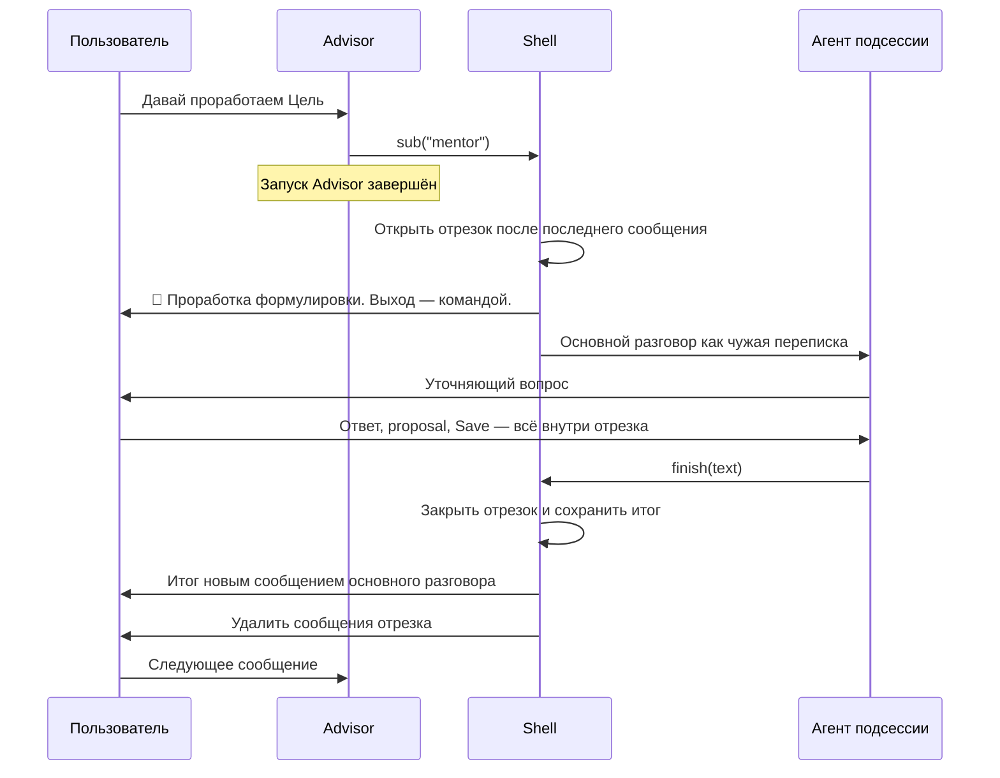
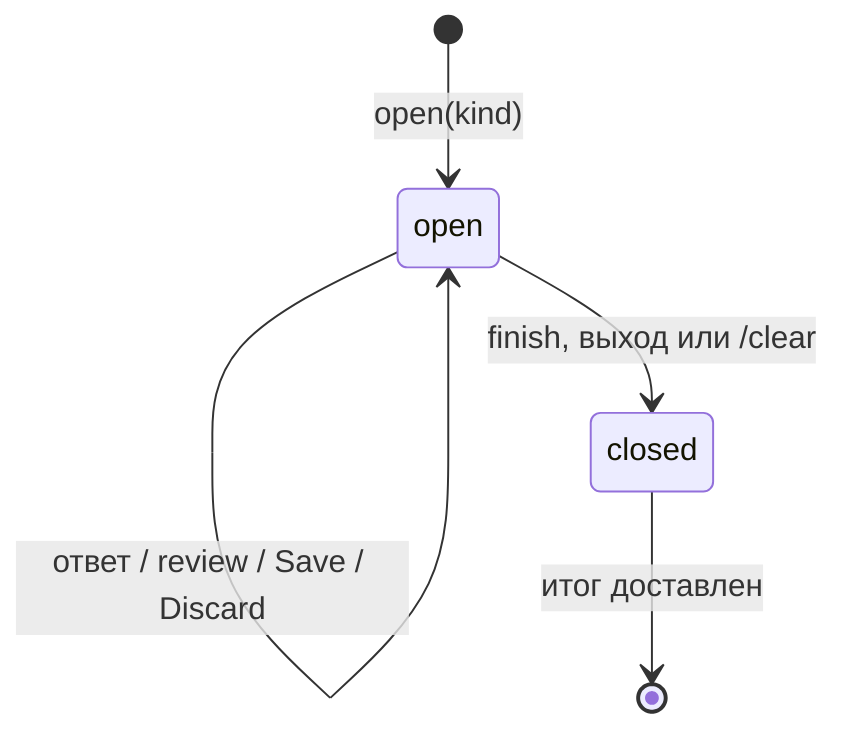

# Подсессии: отдельный разговор внутри чата

Статус: проект для обсуждения, 23 октября 2026 года, упрощённая редакция после ревью.
Это предложение, а не описание реализованного поведения. Код, промпты и утверждённые
сценарии этим документом не меняются.

Подсессия — разговор с выбранным агентом, который занимает несколько сообщений пользователя,
имеет собственную историю и возвращает в основной разговор один текстовый результат.
`mentor` ниже — только пример имени. Агент может читать, предлагать изменения или только
разговаривать: права задаёт его регистрация, а не механизм подсессии.

Критерий успеха: после нескольких сообщений, включая proposal и Save, основной разговор
содержит ровно один итог подсессии и ни одного её промежуточного сообщения. Неудавшееся
удаление сообщений, перезапуск и повторная обработка не нарушают эту границу и не повторяют
сохранённые изменения.

## 1. Решение

Подсессия — это **непрерывный отрезок id сообщений чата** и агент, который отвечает вместо
Advisor, пока отрезок открыт. Всё остальное уже есть: каждый ответ — обычный корневой запуск
`AgentManager` другого вида, изменения проходят существующий механизм proposals, удаление
отрезка — существующий `ChatHost.clear(first, last)`.

| Объект | Время жизни | Что ему принадлежит |
|---|---|---|
| Подсессия | От входа до итога или выхода | Агент, отрезок id, итоговый текст |
| `AgentSession` | Один запрос, включая его Save/Discard | Вызовы, бюджет, claim, transcript |
| `TurnManager` | Обработка одного события | Право исполняться, отмена, актуальность |

Одна открытая подсессия на приватный чат. Вложенных подсессий нет. Число зарегистрированных
агентов не ограничено: ограничена только одновременная активность в одном чате.

## 2. Почему это отдельный уровень

Сейчас [runtime](../src/agent_runtime/manager.py) завершает запуск после ответа словами.
`route` возвращает receipt вызывающему агенту в пределах одного запроса; ожидание человека
существует для review, а не для многоходового разговора.

`sub` передаёт следующие сообщения пользователя другому агенту на несколько запросов.
Это не вариант `route` и не долгий запуск: один запуск на весь разговор нарушил бы правило
«новый запрос — новый бюджет и transcript», а перезапуск по AG-SESSION-009 оборвал бы его.

## 3. Граница переписки: отрезок id

В приватном чате Telegram нумерует сообщения обеих сторон одной последовательностью. Этим
уже пользуются [история](../src/tg_agent_shell/history.py) (`ChatClearBoundary`: разговор
начинается после id) и очистка чата (`ChatHost.clear` удаляет диапазон id). Подсессия
использует то же свойство:

- при входе запоминается `after_message_id` — наибольший id, записанный в чате;
- при закрытии запоминается `through_message_id` — наибольший id на момент закрытия;
- сообщение принадлежит подсессии, если его id лежит в `(after, through]`; у открытой
  подсессии верхней границы нет.

Принадлежность — функция id и строки подсессии. Её не нужно определять при записи и
передавать через `ChatHost`, `Note`, медиа, альбомы, экраны или callbacks: каждый путь
отправки, включая будущие, попадает в нужный разговор без изменений. Удаление по отрезку
захватывает и сообщения, которых нет в истории: команды, удалённый ввод полей.

Отрезок не захватывает чужое, потому что пока подсессия открыта, основной разговор ничего
не получает:

- каждое событие пользователя обрабатывает агент подсессии;
- фоновые публикации ждут: `chat_is_free` ложно при открытой подсессии (раздел 7);
- вход и закрытие выполняются под удерживаемым ходом, а сообщения, пришедшие во время хода,
  middleware уже убирает из чата (AG-TURN-010).

| Читатель | Что получает |
|---|---|
| Advisor, Summary, Diary, чтение дня, Cues | Основной разговор: всё вне отрезков; итог подсессии — его часть |
| Routed-субагент | Окно основного разговора, как сейчас |
| Агент подсессии | Основной разговор как чужая переписка + свой отрезок в собственных ролях |
| Удаление при закрытии | Весь отрезок id |

Исключение отрезков — одно условие в SQL-запросе `TelegramNotes`, поэтому оно применяется
до лимита выборки, подсчёта токенов и поиска Summary: длинная подсессия не вытесняет
основной разговор. `ChatHost.clear` продолжает читать все записи. Окно подсессии читает
сообщения после `after_message_id` и не останавливается на `ChatClearBoundary`: защитная
очистка при блокировке не стирает историю открытого разговора.

Редактирование сообщения не меняет его id и потому его принадлежность. Это изоляция
переписки, а не данных: сохранённая внутри Цель, фото в медиатеке и прочие доменные записи
видны обычным читателям данных. Reply в основном разговоре на ещё видимое сообщение подсессии
переносит цитату, как любой reply: это явное действие пользователя.

## 4. Вход, инструменты, регистрация

Вход — одна операция shell `open(kind)`. Её вызывают:

- `sub(name)` — инструмент корневой сессии, если зарегистрирован хотя бы один агент
  подсессии;
- при необходимости команда или кнопка приложения — без участия Advisor.

`open` в одной транзакции создаёт строку подсессии; база не допускает второй открытой в
этом чате. Затем публикуется рамка (обычное сообщение вида `RECEIPT` внутри отрезка:
название из регистрации и как выйти) и в том же ходе выполняется первый ответ агента.
Падение между шагами оставляет открытую подсессию, следующий ответ даст её агент;
отдельного состояния «открывается» нет.

`finish(text)` — инструмент агента подсессии: закончить разговор с непустым итогом.
Обычный ответ словами продолжает разговор.

Оба инструмента завершающие. Runtime получает одно нейтральное расширение: `AgentDefinition`
перечисляет завершающие инструменты приложения, которые вызываются только поодиночке и
заканчивают запуск. Проверка «только один вызов в ответе» обобщает нынешнюю для `route`,
`forward` и `nothing_to_do` и выполняется до исполнения любого вызова. Инструмент исполняет
`ToolRunner`: при ошибке аргументов модель получает результат-ошибку и продолжает; при успехе
цикл завершается, `AgentLoopResult` несёт завершивший вызов и его результат, и materializer
превращает их в исход для shell. Runtime не узнаёт ни Telegram, ни подсессий.

Регистрация использует существующий `AgentSpec` и добавляет необязательное поле с
отображаемым названием и значком. Такой агент попадает в список `sub`, а не `route`.
Агент подсессии получает объявленные read tools, views, `open`, mutation tools и `finish`;
`route`, `sub` и `forward` в первой версии не получает. Дать ему `route` позже можно:
он обычный корень своего запуска; тогда закрытие должно завершать его незаконченные запуски.

Агент подсессии не Advisor. Там, где shell различает агентов по положению в цепочке, вид
агента подсессии учитывается явно: для tool hooks он не `root` (иначе, например, отказ
`heavy_analyzer` укажет ему на недоступный helper). Shell не знает слов Goal, Action, Value
и не содержит условий по имени агента.

## 5. Контекст

Контекст каждого запроса агента подсессии, по частоте изменений блоков:

1. Стабильный промпт агента.
2. Последние `history_messages` сообщений основного разговора как чужая переписка — тот же
   блок, что получает routed-субагент.
3. Состояние рабочей области, если агент его объявил.
4. Отрезок подсессии в собственных ролях: пользователь, ответы агента с `kept_turn`.
5. Текущие значения агента и время.

Блок 2 читается заново, а не хранится: пока подсессия открыта, основной разговор не
меняется. Поэтому он стоит до состояния, которое меняется после каждого сохранения, и
префикс из блоков 1–2 кешируется на весь разговор.

Окно отрезка ограничено тем же бюджетом токенов, что и основное окно (агент может объявить
свой). Самые ранние ходы длинного разговора выпадают так же, как в основном разговоре.
Отдельного механизма отказов и резервов нет.

Сохранения и отклонения видны агенту в `kept_turn` его ответов — так же, как Advisor видит
свои. Падение процесса после commit Save и до ответа теряет этот ход из переписки так же,
как в основном разговоре; изменение остаётся в данных и видно чтением. Отдельный журнал
фактов не нужен.

Каждое сообщение пользователя запускает новую `AgentSession` с новым бюджетом. Save/Discard
продолжают тот же запуск. Ограничения времени у агента подсессии нет, как у Advisor: оба —
корни своих запусков.

## 6. Предложения и Save

Ничего нового. Агент подсессии — корневой запуск, поэтому `ProposalStore`, review, Edit,
autoapproval, проверка ревизии и транзакционные use cases работают как для Advisor.
Ответ после Save получает пользователь внутри отрезка; Advisor ничего не получает.

Текст поверх review, `/cancel`, просроченный review и команда поверх экрана заканчивают
запрос по нынешним правилам; подсессия остаётся открытой. `finish` не может прийти при
открытом review: запуск, ожидающий review, не спрашивает модель.

## 7. Хранение, состояния, фон

Таблица `subsessions`: `id`, `chat_id`, `kind`, `after_message_id`,
`through_message_id` (пусто, пока открыта), `result`, `created_at`, `closed_at`.
Частичный уникальный индекс по `chat_id` для открытых строк. Существующие таблицы не
меняются.

Закрытие — один условный `UPDATE ... WHERE through_message_id IS NULL`, который ставит
границу, итог и время. Одновременные `finish` и выход выбирают одного победителя.
Доставку отдельно не хранят: итог отправляется с `event_id`, производным от id подсессии,
и наличие записи с этим `event_id` — тот же признак доставки, что у Cue.

`chat_is_free` ложно при открытой подсессии. Этой одной проверкой ждут Cues и Reminders,
автоматическая очистка по тишине и другие фоновые публикации. Истечение review и блокировка
доступа продолжают работать. Хуки хода (`BeforeTurn`, `AfterTurn`: Summary, onboarding)
срабатывают только для ходов основного разговора; учёт использования — для всех.

## 8. Завершение

1. Под удерживаемым ходом: условный `UPDATE` закрывает подсессию, сохраняя итог.
2. Итог отправляется новым сообщением вида `EVENT`, с названием подсессии и `event_id`
   подсессии, через `send_parts`: длина не ограничена одним сообщением. Advisor не
   запускается; следующий запрос пользователя читает итог как системную строку.
3. `ChatHost.clear(first=after + 1, last=through)` удаляет сообщения отрезка из Telegram,
   лучшим усилием, как обычная очистка.

Позднее нажатие кнопки на неудалённом сообщении отрезка не возвращает подсессию: его review
уже закрыт, а открытый экран не является разговором.

Падение между 1 и 2: при старте, там же, где возобновляются Cues, shell доставляет итог
закрытой подсессии без записи с её `event_id`. Падение после 2 или неудавшееся удаление
оставляет сообщения видимыми, но не возвращает их в основной разговор: граница хранится в
базе, а не в Telegram. Telegram удаляет только сообщения моложе 48 часов и не более 100 за
вызов; `ChatHost.clear` уже учитывает оба ограничения. Повторных попыток удаления нет.

Порядок в основном разговоре сохраняется: итог получает id больше границы отрезка и стоит
сразу после инициирующего сообщения пользователя. Рамка лежит внутри отрезка и уходит вместе
с ним.

## 9. Выход, отмена, перезапуск

| Событие | Поведение |
|---|---|
| Пользователь просит закончить словами | Агент вызывает `finish` |
| Команда выхода | Закрыть с фиксированным итогом «Разговор закрыт без итога»; открытый review команда закрывает по нынешним правилам |
| `/cancel` | Остановить текущую генерацию; подсессия остаётся |
| Меню, команда, открытие сущности | Экран появляется внутри отрезка и уходит вместе с ним |
| Явная очистка чата (`ChatAccess.clear`) | Сначала закрыть, как командой выхода, затем очистить |
| Блокировка доступа | Подсессия остаётся открытой; после unlock разговор продолжается |
| Перезапуск при открытой подсессии | Разговор продолжается следующим сообщением; reviews потеряны по AG-SESSION-009 |
| Перезапуск после закрытия до доставки | Итог доставляется при старте |
| Агент больше не зарегистрирован | Следующее событие закрывает подсессию, как командой выхода |

Итог команды выхода не перечисляет сохранения: они в данных, и Advisor видит их в состоянии
рабочей области. Итог со смыслом пользователь получает, попросив агента закончить.

## 10. Где менять код

| Место | Изменение |
|---|---|
| [model](../src/agent_runtime/model.py), [loop](../src/agent_runtime/loop.py) | Завершающие инструменты в `AgentDefinition`, завершивший вызов в `AgentLoopResult`, общая проверка одиночного вызова |
| [история](../src/tg_agent_shell/history.py) | Таблица рядом с `ChatClearBoundary`, `start_subsession`, `close_subsession`, `current_subsession`; исключение отрезков в основном окне; окно отрезка `TelegramHistorySource.subsession` |
| [subsessions](../src/tg_agent_shell/telegram/subsessions.py), [session](../src/tg_agent_shell/session.py) | Вход, закрытие с доставкой итога и удалением отрезка; ход подсессии — `RootSession.talk` |
| [dialogue](../src/tg_agent_shell/telegram/dialogue.py), [media](../src/tg_agent_shell/media/telegram.py) | В начале хода выбрать окно и вид агента; хуки хода только для основного разговора |
| [контекст](../src/tg_agent_shell/ai/messages.py) | Контекст агента подсессии из раздела 5 |
| [tools](../src/tg_agent_shell/ai/tools.py), [manifest](../src/tg_agent_shell/telegram/manifest.py), [registry](../src/tg_agent_shell/registry.py) | Объявление, `sub` у корня, `finish` у агента подсессии, вид агента для tool hooks |
| [outcome](../src/tg_agent_shell/ai/outcome.py), [materialize](../src/tg_agent_shell/proposals/materialize.py), [answer](../src/tg_agent_shell/proposals/telegram/answer.py) | Завершивший вызов → исход «вход» или «итог»; `render_ai_outcome` открывает или закрывает подсессию |
| [Cues](../src/tg_agent_shell/cues/runtime.py) | `chat_is_free` учитывает открытую подсессию; доставка недоставленного итога |
| [доступ](../src/tg_agent_shell/access/manager.py), команды shell | Команда выхода; явная очистка сначала закрывает подсессию |

Не меняются: `ChatHost`, `Note`, `telegram_messages`, `agent_runs`, `take_interrupted_root`,
`TurnManager`, `ProposalStore` и весь путь proposals. Ходы подсессии начинают новый запуск
через `AgentManager.start`, поэтому прерванный запрос другого разговора не подбирается.

## 11. Проверка и порядок внедрения

Сначала согласовать продуктовые решения и тексты для модели, затем один вертикальный путь.
Новые сценарии получат идентификаторы после согласования; существующие не меняются.

1. Граница. Открытая и закрытая подсессии не видны Advisor, Summary, Diary и чтению дня,
   включая подсессию длиннее лимита выборки и бюджета окна; итог виден.
2. Вход, несколько ответов, `finish`, один итог, удаление отрезка. Поддельный агент и
   поддельные tool calls: `finish` вместе с другим вызовом, две попытки входа.
3. proposal → Edit → Save/Discard → продолжение → итог; текст поверх review, просроченный
   review, `/cancel` после сохранения.
4. Сбои: падение после закрытия до доставки, после доставки до удаления, ошибка удаления.
   Итог в истории один, Save не повторяется, модель не вызывается повторно.
5. Фон и доступ: Cue ждёт закрытия, блокировка и unlock посреди разговора, явная очистка.
6. Другой бот: shell-тест без Safwa, один агент только разговаривает, другой сохраняет
   через собственный proposal; оба возвращают итог одним механизмом.

После реализации: затронутые тесты, полная локальная suite, Ruff, архитектурный scanner.
Обновить schema snapshot (новая таблица `subsessions`) и prompt snapshot после согласования
текстов.

Уточнить существующие сценарии: AG-ROUTE-001 и AG-RECEIPT-006 — в подсессии в чат пишет её
агент, которому могут быть разрешены proposals; TG-CLEAR-032 — явная очистка сначала
закрывает подсессию. AG-SESSION-009 не меняется: продолжается разговор, а не запуск.

## 12. Что остаётся согласовать

Продуктовые решения:

- Reminders и Cues ждут конца подсессии. Долгий разговор задерживает видимое напоминание.
- Итог — системная строка без немедленного ответа Advisor.
- Окно подсессии ограничено бюджетом токенов; ранние ходы длинного разговора выпадают.
- Выход командой даёт фиксированный итог без пересказа.
- Вход только через `sub` или также командой/кнопкой приложения.
- Может ли ход Cue открыть подсессию: у него те же инструменты, что у хода пользователя.

Тексты для модели, по [AGENTS.md](../AGENTS.md): строка Advisor о выборе `sub` вместо
`route`; описания `sub` и `finish`; ошибка одиночного вызова с `next`; промпт агента
подсессии о различии ответа и `finish`. Имя `sub` малой модели ничего не говорит; вариант —
`talk`. Механика границы, удаления и транзакций остаётся в коде и в промпты не попадает.
Onboarding manual объясняет вход, выход, итог и сохранность подтверждённых изменений.
Точная формулировка этим проектом не утверждается.
